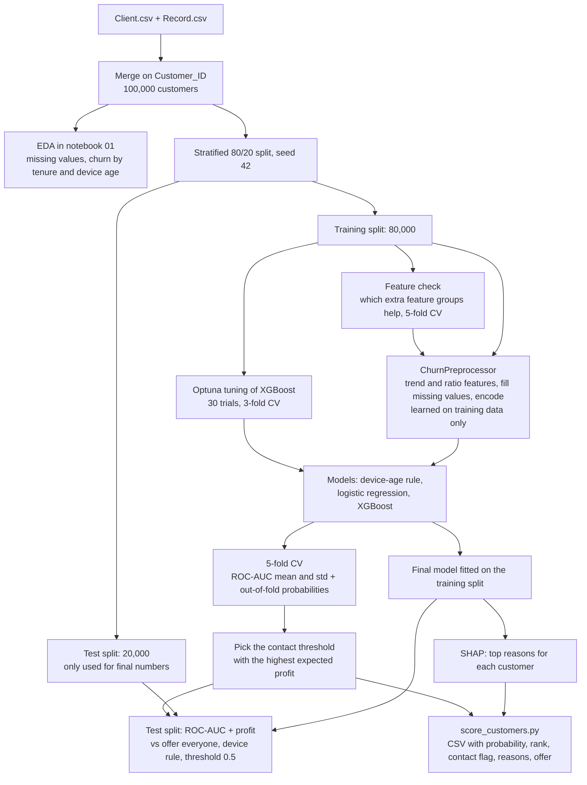
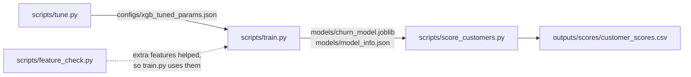
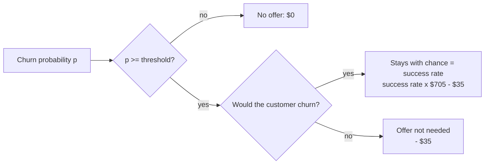
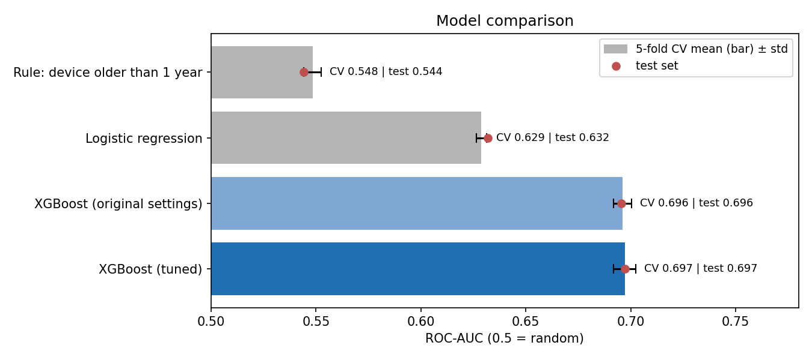
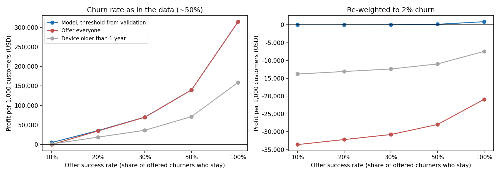
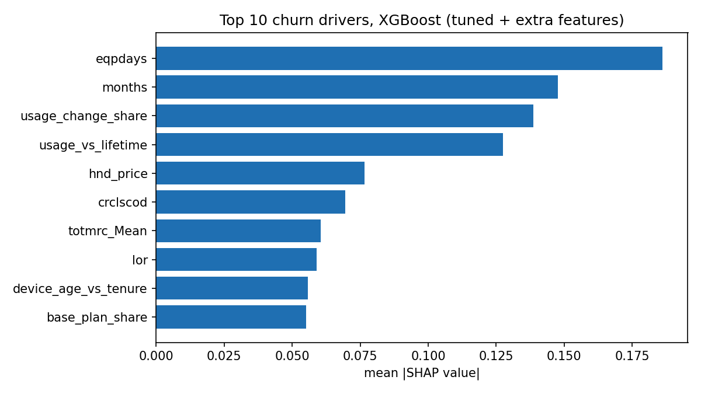
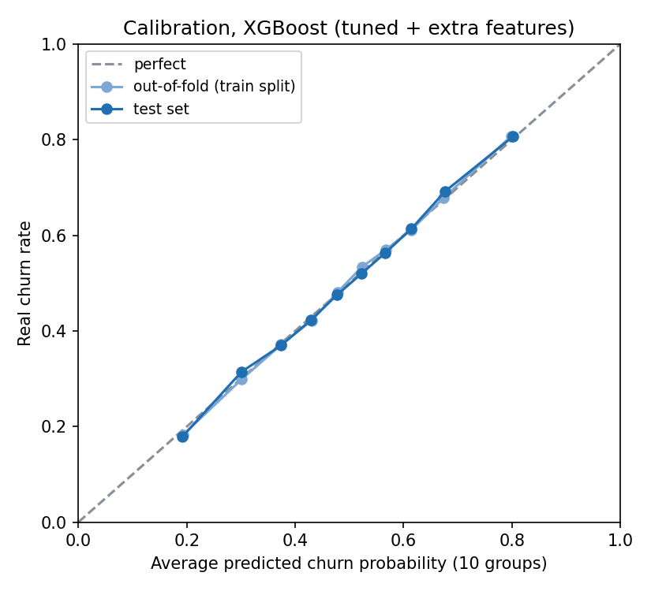
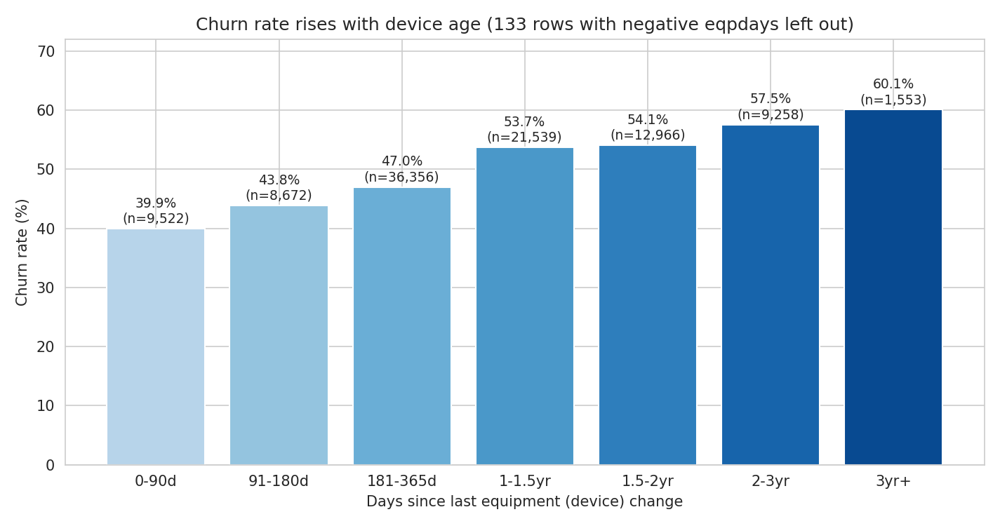
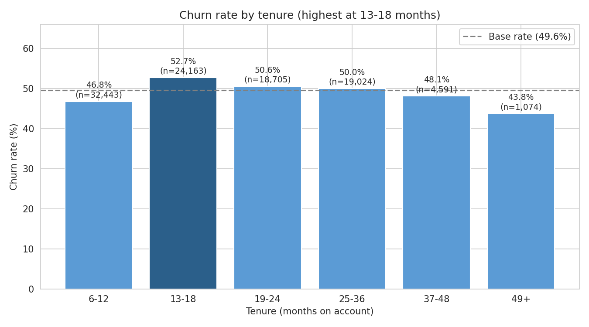

# Telecom Churn Prediction and Profit-Based Retention

Predicting which telecom customers will leave (churn) with XGBoost, deciding who should get a retention offer
based on expected profit, and explaining each prediction with SHAP.

This was my final assignment for the GCI World April 2026 data science course (Matsuo-Iwasawa Lab, University of Tokyo).
I completed the course with a Certificate of Honor ("awarded honors for excellence in the final assessment", August 2026).

The repo has two versions:

- **v1 (submitted):** [`notebooks/01_original_analysis.ipynb`](notebooks/01_original_analysis.ipynb), kept as I
  submitted it and only cleaned up, and the [business proposal slides](docs/proposal_slides.pdf). The slides
  were redesigned later, and their two profit slides now use the v2 analysis.
- **v2 (after the course):** [`notebooks/02_improved_pipeline.ipynb`](notebooks/02_improved_pipeline.ipynb), `src/`
  and `scripts/`. Fixes the weak points of v1: leak-free preprocessing, cross-validation, baselines, tuning, extra
  features, a more honest profit analysis, a calibration check and a script that scores customers.

## Problem

The course gave us data from "Company A", an anonymous mobile telecom operator, for about 100,000 customers.
The brief was to act like a consultant: explore the data, find a business problem, build at least one ML
model, and turn the results into a business proposal with numbers.

I picked **customer churn**. The target column `churn` says whether the customer left 31-60 days after
the observation date. The question is: which customers are likely to leave, why, and is it worth sending
them a retention offer?

## Data

| File | Rows | Columns | Content |
|---|---|---|---|
| `Client.csv` | 100,000 | 50 | account, handset and household info |
| `Record.csv` | 100,000 | 51 | average monthly usage, billing, call quality, tenure, `churn` target |

The two files are joined on `Customer_ID` (one row per customer). The churn rate is 49.6%, so the data is
balanced, which is much higher than real telecom churn. The data is not included in this repo, see
[`data/README.md`](data/README.md).

## How it works

The whole project from data to customer scores:



How the scripts connect:



How the profit of one customer is counted (v2). Profit is measured against running no campaign at all:



$705 is the average monthly revenue in the training data ($58.77) times 12 months, and $35 is the offer cost
from the proposal. The success rate (share of offered churners who really stay) is unknown, so results are
shown for 10% to 100%, with 30% as the middle case.

### v1: the submitted analysis (notebook 01)

1. **EDA**: missing values (they come in groups with the same row count, so they probably come from
   different source systems), churn rate by tenure and by device age.
2. **Feature engineering**: `usage_momentum_ratio = avg3mou / avg6mou` and the same for revenue, to capture
   whether usage is going down recently.
3. **Preprocessing**: `change_mou`/`change_rev` missing -> 0, missing 6-month averages -> 3-month average for
   new accounts, missing `prizm_social_one` kept as its own category, the rest median / "Unknown", then label encoding.
4. **Model**: XGBoost (350 trees, depth 6) on a stratified 80/20 split. ROC-AUC is the main metric.
5. **Profit-based threshold (e-Profits)**: every confusion-matrix cell gets a dollar value and the threshold
   with the highest total profit on the test set is kept.
6. **Explainability**: SHAP bar and beeswarm plots, plus a waterfall plot and suggested action for the
   customer with the highest churn probability in the SHAP sample.

### v2: what I changed after the course (notebook 02, `src/`, `scripts/`)

1. **Leak-free cleaning**: the same cleaning rules as v1, written as a scikit-learn transformer
   (`ChurnPreprocessor`), so medians and category codes are learned from training data only.
2. **5-fold cross-validation** on the training split. The whole pipeline is refitted in every fold.
3. **Baselines**: a rule with no learning ("device older than 1 year") and logistic regression.
4. **Tuning**: Optuna, 30 trials, 3-fold CV on the training split only. The first trial is the v1 setting.
5. **Profit analysis**: success rate added, each customer counted once, threshold picked on out-of-fold
   probabilities and reported on the test set, compared with "offer everyone", and repeated with the data
   re-weighted to a realistic 2% churn rate.
6. **Extra features**: four small groups of ratio features (device, call quality, billing, usage trend),
   checked with the same 5-fold CV. A rule for using them was set before the check.
7. **Calibration check**: do the predicted probabilities match the real churn rates?
8. **Scoring script**: churn probability, risk rank, contact flag, top 3 SHAP reasons and a suggested offer
   for every customer, saved as CSV.
9. **Tests on GitHub Actions**: the unit tests run on every push (`.github/workflows/tests.yml`).

## Results

### v1 (submitted)

| Metric (20,000 test customers) | Value |
|---|---|
| ROC-AUC | 0.6952 |
| Accuracy (threshold 0.5) | 0.6394 |
| Precision / recall for churners (threshold 0.5) | 0.63 / 0.65 |
| Churn rate in the 10% highest / lowest scored customers | 78.6% / 19.4% (overall 49.6%) |

The proposal reported $6,286,002 expected profit on the test set at threshold 0.099 (19,954 of 20,000
customers get an offer). Looking back, that number came mostly from the assumptions: it assumed every offered
churner stays, counted the saved revenue and the avoided $400 replacement cost for the same customer, and picked
the threshold on the test set. Offering everyone gave almost the same result ($6,284,392). v2 fixes this.

### v2: model comparison

| Model | 5-fold CV ROC-AUC (train split) | Test ROC-AUC | Test accuracy (0.5) |
|---|---|---|---|
| Rule: device older than 1 year | 0.548 ± 0.004 | 0.544 | 0.545 |
| Logistic regression | 0.629 ± 0.002 | 0.632 | 0.597 |
| XGBoost, v1 settings (leak-free cleaning) | 0.696 ± 0.004 | 0.696 | 0.638 |
| XGBoost, tuned | 0.697 ± 0.005 | 0.697 | 0.638 |
| XGBoost, tuned + extra features (final model) | 0.703 ± 0.004 | 0.703 | 0.644 |

- XGBoost is clearly better than both baselines.
- Leak-free cleaning did not change the v1 result (0.6956 vs 0.6952), so v1 was not inflated by the leak.
- Tuning gave only about +0.001 in 5-fold CV, which is inside the spread between folds. The v1 settings were
  already close to the best.
- The extra ratio features gave +0.0055 in 5-fold CV and were better in all 5 folds, so they passed the rule
  I set before the check. Alone, each group adds: usage trend +0.0046, billing +0.0014, device +0.0011, call
  quality +0.0004. Comparing the last months with the customer's own history helped the most.

### v2: profit

Profit per 1,000 test customers. The threshold is picked on out-of-fold probabilities of the training split
and then used unchanged on the test set.

| Offer success rate | 10% | 20% | 30% | 50% | 100% |
|---|---|---|---|---|---|
| Model, data as it is (~50% churn) | $5,035 | $35,871 | $70,177 | $139,820 | $314,509 |
| Offer everyone, data as it is | -$49 | $34,901 | $69,852 | $139,753 | $314,505 |
| Model, re-weighted to 2% churn | $1 | $8 | $26 | $155 | $880 |
| Offer everyone, re-weighted to 2% churn | -$33,590 | -$32,179 | -$30,769 | -$27,948 | -$20,896 |

- With half the customers churning, offering everyone is almost as good as using the model, unless offers
  rarely work (10% success).
- With a realistic churn rate (2% here; Mozer et al., 1999 report 2-3% a month for US wireless), offering
  everyone loses money. The model then contacts almost nobody: even with 100% success it contacts only 4.6% of
  customers. In the top 10% of scores, an offer can cost at most about $17 (30% success) to $56 (100% success)
  and still pay off, so the $35 offer from the proposal is too expensive for most customers.
- So the model is useful for ranking customers, but the real churn rate, offer cost and success rate decide
  whether a campaign makes money. A small pilot to measure the success rate should come first.

### v2: calibration

In 10 groups of customers sorted by score, the average predicted probability matches the real churn rate on
both the out-of-fold and the test predictions (Brier score 0.218, against 0.250 for always predicting the
average). These probabilities are for data with ~50% churn; notebook 02 (section 8) shows how to move them to
a real churn rate.

### Main findings from the data

- **Device age** (`eqpdays`) is the strongest driver. Churn goes from about 40% for phones under 90 days old
  to about 60% for phones older than 3 years.
- Churn is highest at **13-18 months** of tenure (52.7% vs 49.6% overall).
- Top SHAP drivers of the final model: device age, tenure (`months`) and the two new usage trend features
  (`usage_change_share`, `usage_vs_lifetime`), then handset price, credit class and monthly plan charge. In v1
  the third driver was `change_mou`, the raw version of `usage_change_share`.
- Each top driver has a weak linear correlation with churn on its own (max |r| = 0.11), so the model relies
  on combinations of features.
- The highest scores mostly go to customers whose usage dropped sharply: a quarter of the top 1,000 had no
  minutes at all in the recent period (`mou_Mean` = 0). Some of them may already be moving to another operator,
  so an offer may come too late for them. Customers with no usage over 6 months get a "check the line" note
  instead of an offer.

| Model comparison | Profit by success rate |
|---|---|
|  |  |

| SHAP feature importance (final model) | Calibration |
|---|---|
|  |  |

| Churn by device age | Churn by tenure |
|---|---|
|  |  |

All figures are in [`outputs/figures/`](outputs/figures/). The `v2_` files come from notebook 02, the rest from
notebook 01.

### Scoring output

`scripts/score_customers.py` writes one row per customer, sorted by risk:

| Column | Meaning |
|---|---|
| `Customer_ID` | customer id |
| `churn_probability` | model output |
| `risk_rank`, `risk_group` | 1 = highest risk; group 1 = top 10% of scores |
| `contact` | probability above the threshold from `train.py` (or in the top N with `--budget N`) |
| `driver_1..3`, `_value`, `_shap` | the 3 features that push this customer's score up the most, their value and SHAP value |
| `suggested_offer` | action for the first driver that has one in the offer list, or a "check the line" note for customers with no usage |

## Limitations

- **The profit numbers depend on assumptions.** The success rate, the $35 offer cost and the 12-month value
  are not from Company A. The 2% re-weighting assumes the balanced data was made by random sampling, so the
  model's ranking still holds at the real churn rate.
- ROC-AUC of about 0.70 is modest. The model ranks customers better than random but is far from precise.
  Tuning and the extra features moved it by less than 0.01.
- The offer list is a simple hand-made mapping for 5 features (the new ratio features use the action of the
  column they come from). About 23% of customers get the general "review account" suggestion.
- SHAP shows what the model uses, not what causes churn. A driver is not proof that an offer on it will work.
- On the course data the scoring script also scores customers the model was trained on, so those scores look
  better than they would for new customers.
- Tuning used 30 trials and 3-fold CV to keep the run time around 30 minutes. More trials might find slightly
  better settings. The settings were tuned before the extra features were added and were not tuned again.
- Only four feature groups were tried, all simple ratios of existing columns.
- The source system names in the missing-value chart (notebook 01) are my guesses.

## Tech stack

Python 3.12, pandas, NumPy, scikit-learn, XGBoost, Optuna, SHAP, matplotlib, seaborn, Jupyter, pytest,
GitHub Actions.

## How to run

```bash
git clone <repo-url>
cd <repo-folder>
python -m venv .venv
source .venv/bin/activate        # on Windows: .venv\Scripts\activate
pip install -r requirements.txt
```

Put `Client.csv` and `Record.csv` in `data/telecom/` (see [`data/README.md`](data/README.md)).

Notebooks (run all cells from top to bottom; figures are saved to `outputs/figures/`):

```bash
jupyter notebook notebooks/01_original_analysis.ipynb    # about 1 minute
jupyter notebook notebooks/02_improved_pipeline.ipynb    # about 6 minutes; loads the saved tuning and feature check results
```

Scripts:

```bash
python scripts/tune.py               # optional, about 30 minutes on 2 CPU cores; the result is already in configs/
python scripts/feature_check.py      # optional, about 10 minutes; the result is already in outputs/features/
python scripts/train.py              # about 2 minutes; saves models/churn_model.joblib and models/model_info.json
python scripts/score_customers.py --budget 1000 --explain-top 1000   # top 1,000 customers, about 20 seconds
python scripts/score_customers.py    # all customers with reasons, about 20 minutes
```

`train.py` uses the extra features by default (`--features original` trains without them) and takes the
assumptions as options, for example `python scripts/train.py --success-rate 0.2 --offer-cost 20 --churn-rate 0.02`.

Tests:

```bash
pytest
```

The tests use small made-up tables, so they do not need the course data. They also run on GitHub Actions on
every push.

Times are from a 2-core cloud machine. The package versions in `requirements.txt` reproduce the numbers above.
Newer XGBoost versions (3.3 and up, with shap 0.53) give slightly different results from the same code
(for example ROC-AUC 0.6950 instead of 0.6952 in notebook 01).

## Project structure

```
.
├── README.md
├── requirements.txt
├── .gitignore
├── .github/workflows/tests.yml         # runs pytest on every push
├── configs/
│   └── xgb_tuned_params.json           # best XGBoost settings from scripts/tune.py
├── data/
│   ├── README.md                       # where the data comes from and where to put it
│   └── telecom/                        # Client.csv, Record.csv (not committed)
├── docs/
│   └── proposal_slides.pdf             # business proposal for Company A (profit slides from notebook 02)
├── notebooks/
│   ├── 01_original_analysis.ipynb      # submitted analysis: EDA -> XGBoost -> profit threshold -> SHAP
│   └── 02_improved_pipeline.ipynb      # CV, baselines, tuning, new profit analysis, SHAP reasons
├── outputs/
│   ├── figures/                        # charts saved by the notebooks
│   ├── features/feature_groups_cv.csv  # 5-fold CV score of each extra feature group
│   └── tuning/optuna_trials.csv        # all 30 tuning trials
├── scripts/
│   ├── tune.py                         # Optuna search on the training split
│   ├── feature_check.py                # do the extra feature groups help?
│   ├── train.py                        # CV threshold + final model
│   └── score_customers.py              # CSV of probability, reasons and suggested offer per customer
├── src/churn/
│   ├── data.py                         # load and merge the CSV files, train/test split
│   ├── preprocessing.py                # cleaning rules and extra features as a scikit-learn transformer
│   ├── models.py                       # device-age rule, logistic regression and XGBoost pipelines, CV helper
│   ├── profit.py                       # profit model and threshold search
│   └── explain.py                      # SHAP values -> top reasons and suggested offer
└── tests/                              # pytest tests for preprocessing, profit and explain code
```

`models/` and `outputs/scores/` are created by the scripts and are not committed.
